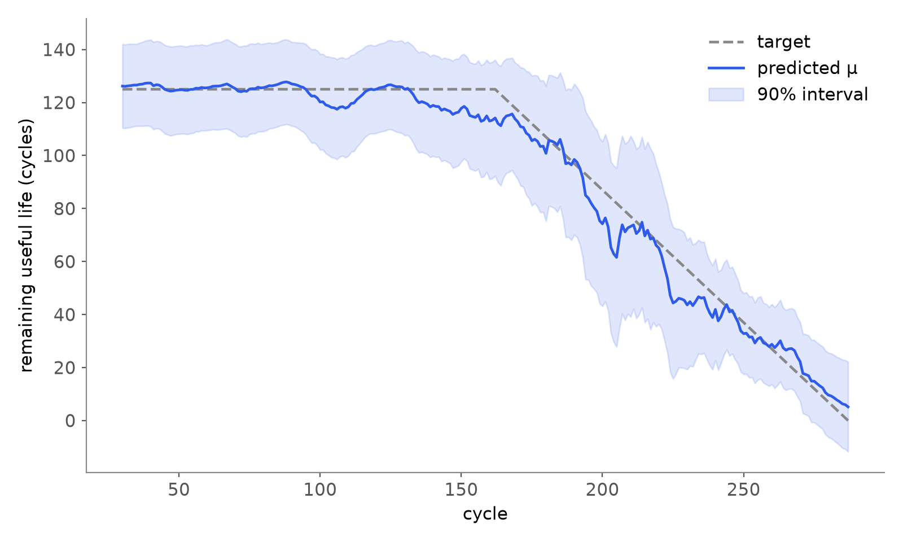
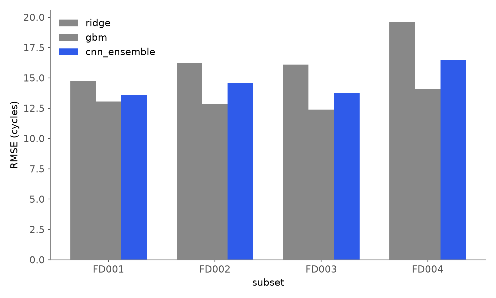
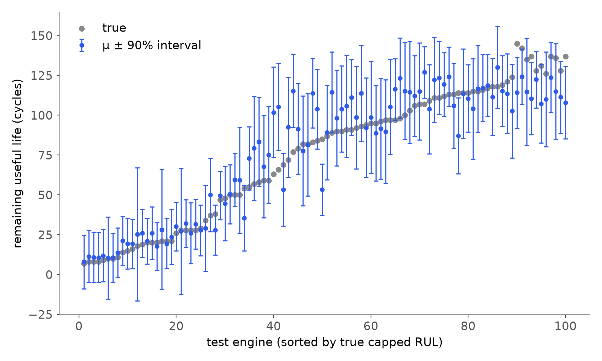

# Remaining useful life of turbofan engines (NASA C-MAPSS)

How many flight cycles does an engine have left, and when should we not trust the answer?
This repository is a small, reproducible study of that question on NASA's C-MAPSS benchmark:
a clean protocol, two classical baselines, and a deep ensemble that predicts its own uncertainty.



## Data

C-MAPSS (Saxena et al., 2008) simulates turbofan engines run to failure. Each engine is a multivariate time series
of 21 sensors and 3 operating settings, one row per cycle. Training engines run until failure; test engines stop
at an unknown point and the task is to predict their remaining useful life (RUL) at the last observed cycle.

| Subset | Operating conditions | Fault modes | Train engines | Test engines |
|---|---|---|---|---|
| FD001 | 1 | 1 (HPC) | 100 | 100 |
| FD002 | 6 | 1 (HPC) | 260 | 259 |
| FD003 | 1 | 2 (HPC, fan) | 100 | 100 |
| FD004 | 6 | 2 (HPC, fan) | 249 | 248 |

`scripts/download_data.sh` fetches the official archive into `data/`.

## Protocol

- **Target.** Piecewise-linear RUL capped at 125 cycles, the usual convention: degradation is not observable early in life.
- **Features.** The 14 informative sensors (2, 3, 4, 7, 8, 9, 11, 12, 13, 14, 15, 17, 20, 21).
- **Regime normalisation.** On FD002 and FD004 the six operating regimes are recovered with k-means on the three
  settings, and every sensor is z-scored *within its regime*. Statistics are fitted on training engines only.
- **Windows.** The last 30 cycles; shorter test engines are padded by repeating their first row.
- **Split.** 20 % of the training engines (fixed seed) are held out for early stopping. The official test set is
  used once, for the numbers below.
- **Metrics.** RMSE in cycles against the capped truth, the asymmetric NASA score (late predictions cost more than
  early ones), and the empirical coverage of the 90 % interval.

## Models

| Model | Input | Notes |
|---|---|---|
| Ridge | flattened 30 × 14 window | linear baseline |
| Gradient boosting | last value, mean, std and slope of each sensor + elapsed cycles | `HistGradientBoostingRegressor`, 500 iterations |
| CNN ensemble | 30 × 14 window | 5 seeds; 4 × Conv1d(10 filters, kernel 10, tanh) → Conv1d(1, kernel 3) → dropout 0.5 → FC 100 → (μ, log σ²) |

The CNN backbone follows Li et al. (2018). Each member outputs a mean μ and a variance σ² and is trained with
10 epochs of MSE warm-up, then the Gaussian negative log-likelihood

$$\mathcal{L} = \tfrac12 \log \sigma^2 + \frac{(y-\mu)^2}{2\sigma^2},$$

with Adam and early stopping on the validation engines. The ensemble is treated as a uniform mixture
(Lakshminarayanan et al., 2017):

$$\mu_* = \frac1M \sum_m \mu_m, \qquad
\sigma_*^2 = \underbrace{\frac1M \sum_m \sigma_m^2}_{\text{aleatoric}} + \underbrace{\frac1M \sum_m \mu_m^2 - \mu_*^2}_{\text{epistemic}}.$$

## Results

Test RMSE (cycles, lower is better), one run of `python src/rul.py --members 5 --epochs 120`:

| Subset | Ridge | Gradient boosting | CNN ensemble | single CNN (mean ± sd of 5) |
|---|---|---|---|---|
| FD001 | 14.73 | **13.06** | 13.59 | 14.06 ± 0.47 |
| FD002 | 16.26 | **12.86** | 14.59 | 15.09 ± 0.25 |
| FD003 | 16.11 | **12.39** | 13.75 | 14.51 ± 0.82 |
| FD004 | 19.60 | **14.10** | 16.46 | 17.10 ± 0.48 |

NASA score (lower is better): gradient boosting 258 / 706 / 264 / 1018, CNN ensemble 355 / 1426 / 374 / 1932.

Uncertainty of the CNN ensemble:

| Subset | 90 % coverage | mean σ | aleatoric σ | epistemic σ | Spearman ρ(σ, \|error\|) |
|---|---|---|---|---|---|
| FD001 | 0.90 | 14.7 | 14.2 | 3.2 | 0.27 |
| FD002 | 0.93 | 15.4 | 14.9 | 3.5 | 0.37 |
| FD003 | 0.88 | 13.9 | 13.2 | 4.0 | 0.39 |
| FD004 | 0.90 | 14.7 | 14.1 | 3.8 | 0.56 |




Ablation (`src/ablation.py`): removing the elapsed-cycle feature from gradient boosting gives
12.38 / 13.40 / 12.86 / 14.74. It helps on FD002–FD004 and hurts on FD001, and gradient boosting without it still beats the CNN
ensemble on every subset.

## What this shows

1. **Regime normalisation matters more than the network.** With the same backbone, Li et al. (2018) report
   12.61 / 22.36 / 12.64 / 23.31 RMSE. The gap on the multi-condition subsets FD002 and FD004 almost disappears here
   (14.59 and 16.46), so most of their difficulty comes from mixing operating regimes, not from the degradation itself.
   The protocols differ (validation split, single run), so this is indicative, not a leaderboard claim.
2. **A strong tabular baseline wins on point accuracy.** Four statistics per sensor over the window are enough to beat the CNN
   on all four subsets, in RMSE and in NASA score. Deep models on C-MAPSS should always be reported next to such a baseline.
3. **The deep ensemble earns its place through calibration.** Its 90 % intervals cover 88–93 % of test engines,
   and the predicted σ rises with the actual error, most clearly on FD004 (ρ = 0.56). Nearly all of σ is aleatoric:
   the members agree, but the sensors cannot pin the failure cycle down to better than about ±15 cycles.
4. **Ensembling helps.** Averaging five members improves RMSE by 0.5–0.8 cycles over a single member.

Next steps: give the CNN the elapsed-cycle signal, compare against a recurrent or attention model under the same
protocol, and repeat over several split seeds to put error bars on the comparison.

## Reproduce

```bash
pip install -r requirements.txt
bash scripts/download_data.sh
python src/rul.py --members 5 --epochs 120   # results/*.json, about 25 min on 8 CPU threads
python src/ablation.py
python src/figures.py
python -m pytest
```

## References

- A. Saxena, K. Goebel, D. Simon, N. Eklund. *Damage propagation modeling for aircraft engine run-to-failure simulation.* PHM 2008.
- G. S. Babu, P. Zhao, X.-L. Li. *Deep convolutional neural network based regression approach for estimation of remaining useful life.* DASFAA 2016.
- X. Li, Q. Ding, J.-Q. Sun. *Remaining useful life estimation in prognostics using deep convolution neural networks.* Reliability Engineering & System Safety, 2018.
- B. Lakshminarayanan, A. Pritzel, C. Blundell. *Simple and scalable predictive uncertainty estimation using deep ensembles.* NeurIPS 2017.
